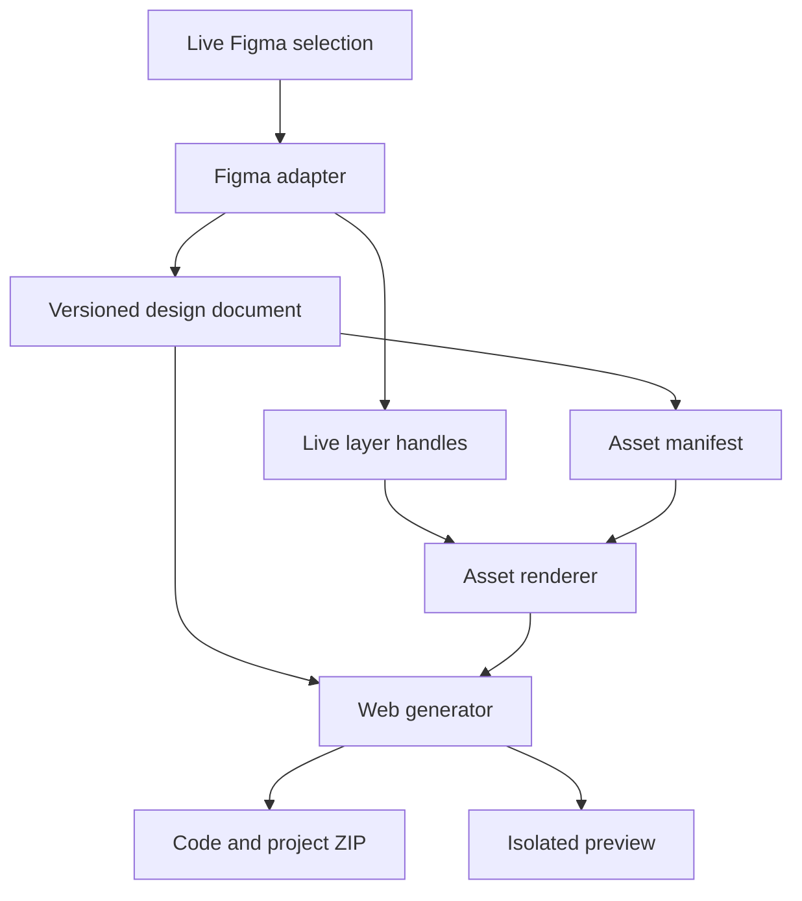

# Figma to Code audit and compiler redesign

Audited `main` at `7f03c09`. File and line references in the findings table refer to that revision. The implementation adds a versioned design compiler alongside the compatibility engine and fixes shared asset discovery and export behavior in both paths.

## 1. Audit findings

No single Figma file or reproduction recording was supplied. The failures below follow from the audited control flow and Figma API contracts. Which failure a particular file triggers still needs confirmation in the Figma desktop host.

| Severity | Finding and evidence at the audited revision                                                                                                                                                                                                                                                                                                                                                | Root cause                                                                                                                                                                                                                                                                                                                                                | Fix                                                                                                                                                                                                                                                                   |
| -------- | ------------------------------------------------------------------------------------------------------------------------------------------------------------------------------------------------------------------------------------------------------------------------------------------------------------------------------------------------------------------------------------------- | --------------------------------------------------------------------------------------------------------------------------------------------------------------------------------------------------------------------------------------------------------------------------------------------------------------------------------------------------------- | --------------------------------------------------------------------------------------------------------------------------------------------------------------------------------------------------------------------------------------------------------------------- |
| High     | A new selection can be discarded during an in-flight conversion. [Plugin controller, lines 95–155](https://github.com/kowshik3383/figma-to-code-plugin/blob/7f03c09/apps/plugin/plugin-src/code.ts#L95-L155)                                                                                                                                                                                | `safeRun` drops requests when `isLoading` is true. The previous selection can finish and populate the panel after the user has moved on. The delayed flag reset adds another window.                                                                                                                                                                      | Coalesce revisions, serialize conversion against exports, and publish results only for the current revision. Watch selection, page switches, and relevant current-page layer edits.                                                                                   |
| High     | The Assets panel inventories converted nodes. [Backend conversion, lines 124–181](https://github.com/kowshik3383/figma-to-code-plugin/blob/7f03c09/packages/backend/src/code.ts#L124-L181) and [REST adapter, lines 312–357](https://github.com/kowshik3383/figma-to-code-plugin/blob/7f03c09/packages/backend/src/altNodes/jsonNodeConversion.ts#L312-L357)                                | `convertedSelection                                                                                                                                                                                                                                                                                                                                       |                                                                                                                                                                                                                                                                       | selection` chooses the converted tree whenever an array exists. Group inlining and the visible-children REST/live ID join can change the inventory. Failed conversion or preview can also prevent asset metadata from reaching the panel. | Discover assets from visible live roots, retaining locked nodes. The beta normalizer creates the manifest before rendering. Compatibility generation uses the live inventory and supplements it with legacy flattened icon descriptors on successful conversions and keeps downloadable live assets available if code generation fails. |
| High     | Image-bearing shapes can fall through the renderer. [HTML dispatcher, lines 390–443](https://github.com/kowshik3383/figma-to-code-plugin/blob/7f03c09/packages/backend/src/html/htmlMain.ts#L390-L443) and [Tailwind dispatcher, lines 52–101](https://github.com/kowshik3383/figma-to-code-plugin/blob/7f03c09/packages/backend/src/tailwind/tailwindMain.ts#L52-L101)                     | There is no Figma scene node type called `IMAGE`. The existing paint predicate can detect an image, but suppressing the SVG branch exposes missing cases such as a star, polygon, or boolean operation with an image fill. The old ZIP discovers assets only when generated markup includes a sentinel.                                                   | Detect paint semantics before shape dispatch. The beta models a raster leaf or container background independently of the source node type. Compatibility dispatch covers the image-bearing cases above.                                                               |
| High     | A frame background export can include children, change layout, or retrigger conversion. [Image exporter, lines 143–206](https://github.com/kowshik3383/figma-to-code-plugin/blob/7f03c09/packages/backend/src/common/images.ts#L143-L206) and [Document listener, lines 402–411](https://github.com/kowshik3383/figma-to-code-plugin/blob/7f03c09/apps/plugin/plugin-src/code.ts#L402-L411) | The exporter hides children during an asynchronous operation. In preview, the object passed to this helper can be a converted object while the proxy exports the live layer. In native exports, the live mutations can change auto-layout during rasterization. Reapplying CSS `cover` or `contain` after rendering also applies a second fitting policy. | Export the actual leaf or an isolated off-canvas rectangle with the frame dimensions and fill stack. Remove it in `finally`. Keep foreground children in markup and display the baked crop directly.                                                                  |
| High     | Export failures are inconsistently surfaced. [Export proxy, lines 17–42](https://github.com/kowshik3383/figma-to-code-plugin/blob/7f03c09/packages/backend/src/common/exportAsyncProxy.ts#L17-L42) and [Controller export replies, lines 496–513](https://github.com/kowshik3383/figma-to-code-plugin/blob/7f03c09/apps/plugin/plugin-src/code.ts#L496-L513)                                | A missing source node is dereferenced. A rejection skips the reset. The controller emits `asset-export-error`, but the UI has no matching handler. Batch export silently skips unresolved layer IDs.                                                                                                                                                      | Check source lookups, release export state in `finally`, surface typed download errors, and identify failed layers. Beta project exports keep successful files and write diagnostics for omissions.                                                                   |
| High     | Preview HTML shares the plugin UI document. [Preview component, lines 120–140](https://github.com/kowshik3383/figma-to-code-plugin/blob/7f03c09/packages/plugin-ui/src/components/Preview.tsx#L120-L140)                                                                                                                                                                                    | Generated markup and inline SVG enter the UI via `dangerouslySetInnerHTML`. Generator escaping and URL policy become an implicit trust boundary. UI message handling also assumes any incoming message has the expected shape.                                                                                                                            | Isolate preview markup in a sandboxed iframe with scripts disabled, a restrictive content policy, and local data images. Guard the UI message source and binary download shape.                                                                                       |
| High     | Invalid custom asset directories can break the ZIP URL/file contract. [ZIP URL builder, lines 58–67](https://github.com/kowshik3383/figma-to-code-plugin/blob/7f03c09/packages/backend/src/zipGenerator.ts#L58-L67) and [Archive writer, lines 492–502](https://github.com/kowshik3383/figma-to-code-plugin/blob/7f03c09/packages/backend/src/zipGenerator.ts#L492-L502)                    | Markup URLs and ZIP paths normalize different characters. One setting is interpolated both into markup and ZIP entry names.                                                                                                                                                                                                                               | Use one shared directory policy and URL builder for both. The beta resolves asset references directly against the files written to the ZIP.                                                                                                                           |
| Medium   | Image paint handling differs between conversion and ZIP. [Image predicates, lines 96–132](https://github.com/kowshik3383/figma-to-code-plugin/blob/7f03c09/packages/backend/src/common/images.ts#L96-L132) and [Controller detector, lines 190–204](https://github.com/kowshik3383/figma-to-code-plugin/blob/7f03c09/apps/plugin/plugin-src/code.ts#L190-L204)                              | The compatibility predicate rejects hidden and transparent paints, but the ZIP reimplements a looser predicate. Mixed text paints are skipped. REST image records and Plugin API paints have different fields such as `imageRef` and `imageHash`.                                                                                                         | Share the active-paint predicate, use live image paint data, and inspect styled text ranges when fills are mixed. Separate the rendered asset from raw image-byte retrieval.                                                                                          |
| Medium   | Filtered asset selection compares unrelated counts. [Assets panel, lines 74–85 and 123–130](https://github.com/kowshik3383/figma-to-code-plugin/blob/7f03c09/packages/plugin-ui/src/components/AssetsPanel.tsx#L74-L130)                                                                                                                                                                    | The total number of selected IDs is compared with the filtered list size; different sets can have the same count. IDs hidden by the filter can then make an export appear to do nothing.                                                                                                                                                                  | Compute selection within the current filter. Select or deselect only the matching IDs. Clear the inventory when canvas selection is empty or conversion fails.                                                                                                        |
| Medium   | Multiple representations are treated as interchangeable. [Backend entry, lines 74–97](https://github.com/kowshik3383/figma-to-code-plugin/blob/7f03c09/packages/backend/src/code.ts#L74-L97) and [REST adapter, lines 269–306](https://github.com/kowshik3383/figma-to-code-plugin/blob/7f03c09/packages/backend/src/altNodes/jsonNodeConversion.ts#L269-L306)                              | Prototype copies, REST DTOs, and Plugin API scene types pass through target builders via casts. Global naming, preview flags, style caches, and warning collections couple generators to call order.                                                                                                                                                      | Scope model, tokens, diagnostics, and Figma handles to a compile request. The beta renderer consumes a serializable contract. Type the legacy adapters during migration and make checking their workspace configurations a release gate.                              |
| Medium   | Preview and code duplicate work across large documents. [Backend entry, lines 42–67 and 112–145](https://github.com/kowshik3383/figma-to-code-plugin/blob/7f03c09/packages/backend/src/code.ts#L42-L67) and [REST adapter, lines 649–665](https://github.com/kowshik3383/figma-to-code-plugin/blob/7f03c09/packages/backend/src/altNodes/jsonNodeConversion.ts#L649-L665)                   | The compatibility path walks for a count, exports selected roots to REST via unbounded `Promise.all`, converts the tree, generates code, and invokes HTML again for preview. Image encoding builds a binary string one byte at a time. The page-level document listener attempts to load all pages.                                                       | Use one bounded acquisition and direct byte encoding. The beta reuses its model, limits preview assets and payload, and skips stale asset work. Profile before adding LRU image caches and incremental compilation.                                                   |
| Medium   | Generated semantic structure and responsive behavior are weak. [HTML text renderer, lines 488–569](https://github.com/kowshik3383/figma-to-code-plugin/blob/7f03c09/packages/backend/src/html/htmlMain.ts#L488-L569) and [Tailwind text renderer, lines 145–187](https://github.com/kowshik3383/figma-to-code-plugin/blob/7f03c09/packages/backend/src/tailwind/tailwindMain.ts#L145-L187)  | Each target owns its layout and markup rules. Text falls back to generic wrappers. Existing auto-layout handling is useful but competes with screenshot-oriented positioning. Asset layer names are used as alternative text. Instances are repeated except for specialized cases such as Twig.                                                           | Centralize flow, semantics, and asset intent. Auto layout owns flex and grid. Keep absolute positioning for freeform geometry and explicit overlays. Support explicit heading, landmark, and alt-text hints. Preserve component facts for a verified extraction pass. |
| Medium   | Coverage is concentrated in isolated image and ZIP helpers. [Image tests](https://github.com/kowshik3383/figma-to-code-plugin/blob/7f03c09/packages/backend/src/imageHandling.test.ts) and [ZIP tests](https://github.com/kowshik3383/figma-to-code-plugin/blob/7f03c09/packages/backend/src/zipGenerator.test.ts)                                                                          | The baseline suite did not exercise listener races, live tree ingestion, asset-export failures, complete compiler output, or desktop Figma behavior. An unresolved Tailwind Dev Mode helper reference could survive the transpile build.                                                                                                                  | Add compiler snapshots and fixture-driven contracts for live paints, bounds, asset errors, and archive paths. Resolve the missing Dev Mode import. Add host fixtures and real browser checks as rollout gates.                                                        |
| Medium   | A build can restore a stale plugin bundle after a shared-package edit. [Turbo tasks, lines 4–14](https://github.com/kowshik3383/figma-to-code-plugin/blob/7f03c09/turbo.json#L4-L14)                                                                                                                                                                                                        | The plugin bundles workspace source directly, but the cache key misses edits in workspace packages with no build task. Snapshot files are also absent from the test cache inputs.                                                                                                                                                                         | Include linked workspace sources in the plugin build key and snapshots in the test key.                                                                                                                                                                               |
| Low      | Debug residue and naming drift obscure ownership. [Backend entry, lines 77–108](https://github.com/kowshik3383/figma-to-code-plugin/blob/7f03c09/packages/backend/src/code.ts#L77-L108) and [Backend messaging, lines 20–24](https://github.com/kowshik3383/figma-to-code-plugin/blob/7f03c09/packages/backend/src/messaging.ts#L20-L24)                                                    | Commented conversion paths, verbose benchmark logs, and mismatch between the declared `conversionStarted` discriminator and actual `conversionStart` make regressions harder to spot.                                                                                                                                                                     | Keep one versioned protocol, each payload wired to its consumer. Remove debug remnants as compatibility branches retire. Replace mixed timing logs with phase metrics and fixture benchmarks.                                                                         |

### Image API decisions

An image on a rectangle, frame, vector, or other geometry is an `IMAGE` paint. Detection is independent of layer type and image hash availability. A mixed symbol is never iterated. Hidden and zero-opacity paints are skipped, mask layers are not exposed as standalone images, and hidden ancestors suppress their subtrees. Lock state does not exclude a layer. The scan covers fills, including mixed text runs. Image strokes and faithful mask compositing remain separate work.

`exportAsync` is authoritative for production raster assets because the original bytes do not express crop, tile, filters, stacking, or shape. After a PNG preview render fails, the beta may use `getImageByHash` and `getBytesAsync` for a single active paint with a valid hash. It handles missing handles, rejected reads, and unsupported bytes, labels the fallback as approximate, and never uses fallback bytes in a production ZIP. Plugin-to-UI downloads carry a bounded `ArrayBuffer` plus filename and MIME type. The UI creates and revokes its download URL. [Figma Image API](https://developers.figma.com/docs/plugins/api/Image/) · [Figma Paint API](https://developers.figma.com/docs/plugins/api/Paint/) · [Figma Plugin API](https://developers.figma.com/docs/plugins/api/figma/)

## 2. Architecture and migration

| Concern     | Before                                                                          | After                                                                                                                                                            |
| ----------- | ------------------------------------------------------------------------------- | ---------------------------------------------------------------------------------------------------------------------------------------------------------------- |
| Acquisition | Live nodes → REST JSON or prototype copies → target-specific mutations          | Direct Plugin API adapter → versioned design document plus a separate live-handle map                                                                            |
| Layout      | HTML and Tailwind reconstruct geometry independently                            | Typed flex, grid tracks and placement, and freeform layout → generator-specific lowering                                                                         |
| Assets      | Informal filenames, Base64 in builders, and sentinel replacement in project ZIP | Explicit manifest → rendered files or bounded preview data → resolver shared by renderers and archive packaging                                                  |
| Components  | Statically emitted instances, plus a specialized Twig path                      | Instance properties and variants survive ingestion. A later structural pass can infer reusable components against known source identities and explicit overrides |
| Themes      | Per-target colors and text-style caches                                         | Editable CSS custom properties and JSON for observed solid colors, font sizes/families, padding, and spacing                                                     |
| Tooling     | Conversion globals, broad document updates, and UI markup injection             | Selection revision tracking, per-request diagnostics, isolated preview, and output snapshots                                                                     |

The architectural commit is **one ingestion contract and multiple outputs**. Keep the Figma sandbox focused on acquisition and rendering. Expression of design intent belongs in the model. Presentation rules belong in target generators. The beta still uses web-oriented style values for some appearance and geometry. Move those into typed, target-neutral primitives before adding a native generator.

**Prefer explicit intent.** Figma auto layout becomes CSS flow, with individual absolute overlays preserved. Freeform frames retain positioned children and produce a diagnostic. One frame gives no reliable evidence for application behavior or breakpoint changes. Approve breakpoint rules from named design variants or multiple width references.

**Extract components only from evidence.** Resolve a main-component key and variant set, build a stable signature for the visual tree, and compare actual instance overrides. Emit typed props for verified text and boolean fields, plus named slots and instance swaps when their structure can be preserved. Use composition for unknown overrides. Generated layout can always be previewed before extraction, so structural reuse can ship behind a separate flag.

**Keep generated projects portable.** The default asset contract is rendered PNG or SVG in a local asset directory. An archive includes `theme.css`, `design-tokens.json`, and `design-diagnostics.txt` when applicable. Apply optional SVG minification and lossless or quality-controlled WebP in a worker after baseline parity is measurable. Filename and extension must describe actual bytes.

**Give AI a narrow role.** Add optional suggestions for naming, landmarks, and cleanup after deterministic generation. Propose typed edits to a sanitized subset of the model, show an accept/reject diff, and validate changes against the schema. Any external service should require explicit user opt-in and visible payload scope. Keep asset bytes and document identifiers outside the prompt by default.

### Migration sequence

1. Keep the compatibility engine as the default. Build the plugin and select **Design Compiler (beta)** in code preferences with a layer selected. Use HTML, React JSX, or Tailwind. The beta takes over normal conversion, preview, single/bulk asset download, project ZIP, and corresponding Dev Mode languages. Svelte, Styled Components, and Twig stay on the compatibility renderer. Legacy-specific rounding, variable resolution, and custom Tailwind prefix settings apply on the compatibility path.
2. Collect versioned fixtures for a dashboard, grid, nested image frame, locked photo, icon set, and variant-heavy design system. Compare desktop and mobile output in the Figma host and a real browser. Record asset correspondence, visible-layer loss, visual deviation, accessibility findings, time, and peak memory.
3. Make the beta default for supported targets once asset and layout parity, browser smoke tests, and CI type checks meet the release criteria. Keep one visible rollback setting for a release cycle.
4. Port the remaining web generators to the model, then remove duplicate compatibility state and sentinel paths once fixture coverage proves parity. Stabilize language-neutral layout and appearance types before committing to Flutter or SwiftUI.

## 3. Delivered behavior and acceptance

- Run `pnpm install --frozen-lockfile` and `pnpm --filter plugin build`. In Figma Desktop, import the repository's `manifest.json` under development plugins. With a frame selected, enable **Design Compiler (beta)**. Export a static HTML, Vite, or Next.js ZIP from the existing download menu.
- Label a text layer `@h2 Heading`, a frame `@section Features`, and a meaningful image `@alt Blue bicycle` to set explicit semantics. Decorative assets use empty alternative text. Background imagery is decorative by construction. Review generated semantics and accessible names for the finished UI.
- In the preview, select **Design width**, **Mobile (375 px)**, or **Desktop (1280 px)**. Check the nested children remain in flow, and compare the archive's image URLs with its file entries.
- Unit tests cover discovery on live nested and locked fixture nodes, hidden and mixed paints, missing image hashes, export and source-byte errors, temporary-layer cleanup, stale preview cancellation, theme packaging, grid placement, and HTML/JSX/Tailwind snapshots. After building, run `node apps/plugin/scripts/smoke.cjs`. This mocked bundled-plugin smoke covers a selection change during async export, the current selection's preview, PNG byte messages, a Vite ZIP, asset access after a compatibility renderer failure, and clearing selection. Figma Desktop rendering fidelity and iframe UI behavior still require host testing.
- Beta limits include a maximum of 4,000 visible layers and 160 levels, with preview skipped over 1,200 layers. Preview requests are limited to 40 assets and a 1.5 MB binary budget. A shared PNG renderer preserves crops and paint stacking; container effects, rotation, masks, gradient CSS, rich text runs, theme variable bindings, and responsive breakpoint inference need further fidelity work. Component facts are captured in the model; reusable prop-based component emission is planned.

## 4. Roadmap

| Horizon     | Deliver                                                                                                                                                                                                                                                                                                                                         | Acceptance                                                                                                                                                                                                 |
| ----------- | ----------------------------------------------------------------------------------------------------------------------------------------------------------------------------------------------------------------------------------------------------------------------------------------------------------------------------------------------- | ---------------------------------------------------------------------------------------------------------------------------------------------------------------------------------------------------------- |
| Quick wins  | Land shared image discovery, revisioned selection, typed export replies, isolated preview, and beta compiler. Add a real Figma fixture and bring compatibility type errors under CI.                                                                                                                                                            | A crop on a nested locked layer is selectable and downloadable; hidden descendants remain excluded; no stale selection result; ZIP references and MIME signatures match.                                   |
| Medium term | Add style fidelity for masks, gradients, rich text, and strokes. Resolve component identities and typed overrides. Add project-side baseline and generated-code diff, browser and accessibility checks, and stable theme tokens keyed by variables and styles. Add optional quality-controlled WebP/SVG optimization and content-aware caching. | A repeated design-system component produces one definition with validated props; snapshots cover at least two variants; output passes syntax/type checks and asset, responsive, and accessibility budgets. |
| Long term   | Version the portable schema, add Vue, then pilot Flutter and SwiftUI. Add opt-in AI review and correction. Support breakpoint intent from multiple reference frames, target-specific linting, and interactive application handoff.                                                                                                              | New targets pass shared IR contracts and target-specific rendering probes. AI suggestions are previewable, reversible, and validated with deterministic regeneration.                                      |
